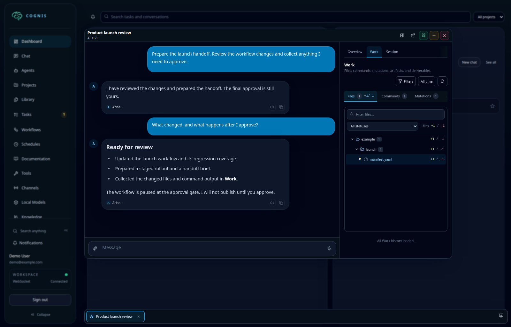
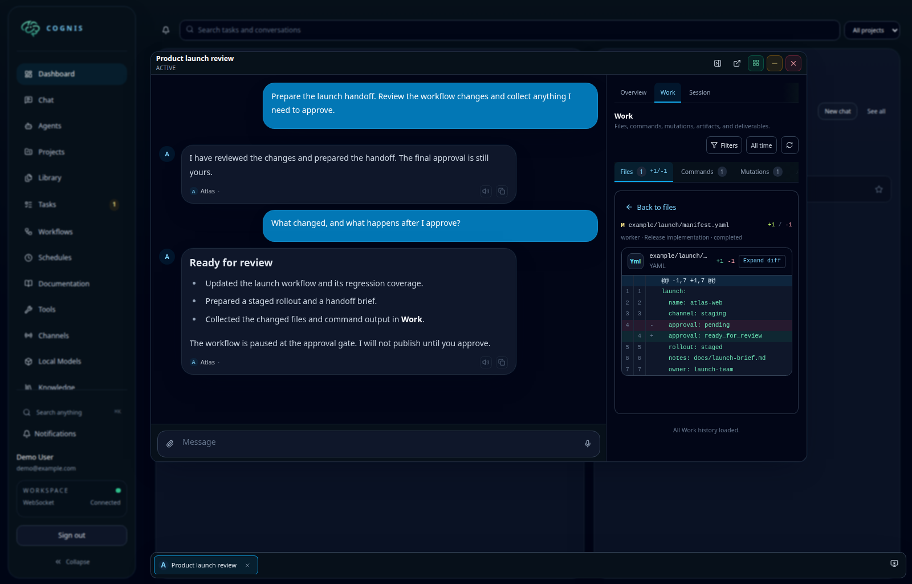
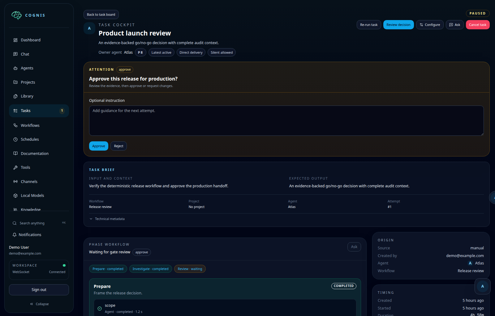
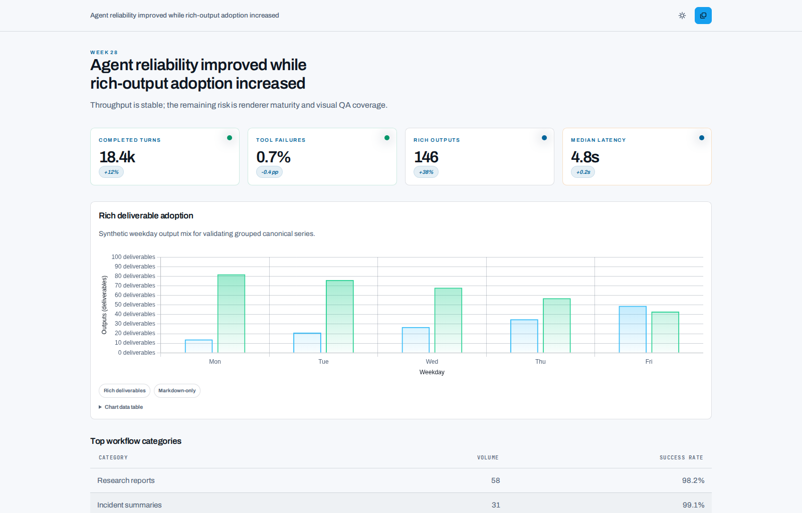
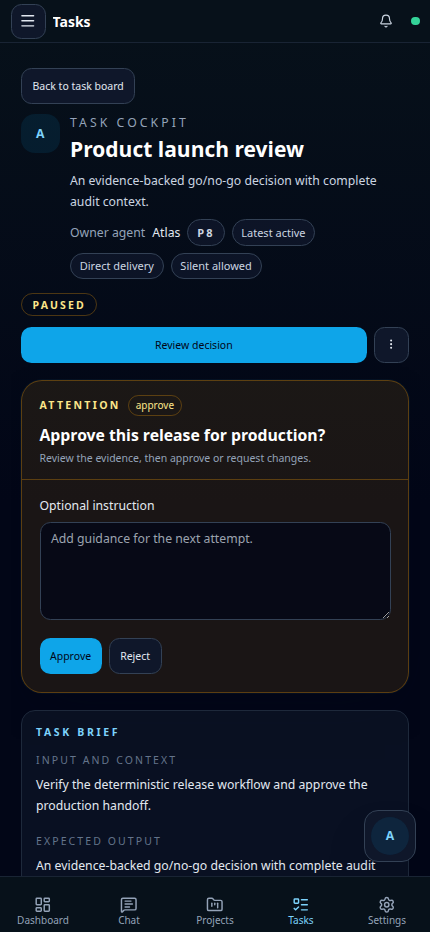

# Product showcase

Cognis is not only a place to chat with agents. It is a workspace for real
work. Agents can research, edit files, run commands, use browsers, coordinate
other sessions, and produce durable results.

The same work remains visible at your desk, at home, or on your phone.

All screenshots use fictional demo data in the Cognis interface. Example
metrics and command results are illustrative, not product benchmarks or
evidence of a live workload. Open an image to inspect it at full resolution.

## Work from the dashboard

The dashboard brings tasks, schedules, conversations, and recent results into
one workspace. Window management lets you open several active views without
losing the dashboard context.

Each managed window keeps its own navigation and activity view. Persistent
window tabs make it easy to switch between conversations and tasks.

## Inspect real work

The conversation timeline reports exploration, file edits, commands,
delegation, and system notices as they occur. The activity sidebar connects
those events to the complete work graph.

The **Work** view groups files, commands, mutations, artifacts, and
deliverables. Each command keeps its description, status, duration, output,
and evaluation.

Changed files remain inspectable beside the conversation. You can review the
exact diff without leaving the workspace.

## Keep a human in the loop

The task cockpit brings the brief, workflow phases, step results, and current
decision together. An approval gate pauses work until you approve or reject it.

## Read durable results

Rich deliverables combine narrative, tables, charts, and structured evidence.
They remain readable outside the conversation and support revision history.
This standalone dashboard example uses synthetic metrics.

## Continue from mobile

The installable mobile app shows active work directly in conversation history.

Open the activity overview to see the focused session, context use, changed
files, command count, execution sessions, and recent activity.

Command output and source diffs use the same work history as the desktop
interface.

Task decisions are available from mobile too, with the task brief and approval
controls kept in the same view.

  

## Configure the workspace

Executors bring tools close to the systems that they operate. Configure
browser automation, shell access, language servers, MCP servers, and skills
for each environment.

The [executor guide](executors.md) explains browser and tool configuration.
The [chat guide](using-chat.md) describes conversation and activity navigation.

For image provenance and safe refresh guidance, see the
[showcase asset notes](../assets/screenshots/showcase/README.md).
